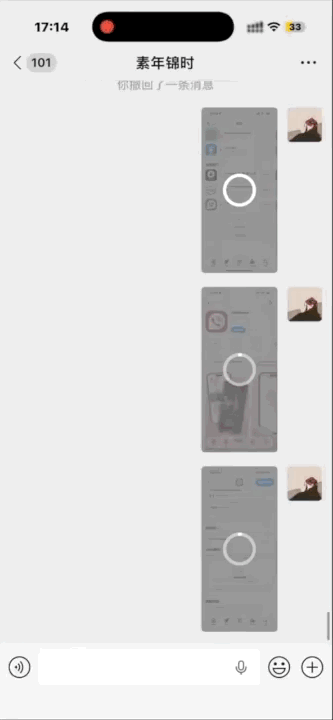
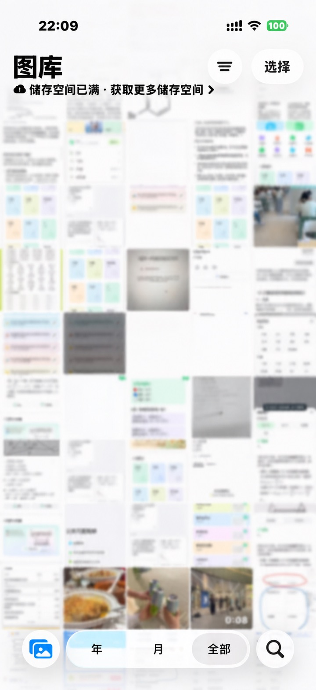

<p align="right"><strong>简体中文</strong> · <a href="./README_EN.md">English</a></p>

# ShotCleanup · 截图清理

> 截图发出去之后，顺手把它从相册里送走。

[](https://www.apple.com/ios/)
[](https://www.swift.org/)
[](./docs/how-it-works.zh-CN.md)
[](./LICENSE)

<p align="center">
  <a href="./assets/shotcleanup-demo.mp4"></a>
</p>

我是一名产品经理，每天都会截很多图：测试产品时发现问题，截图发到群里；看到不错的设计，截图发给同事。

这些图解决的都是当下的问题。发出去后，我会继续工作，不会特意退出聊天、打开相册，再把刚才的截图找出来删除；我也没有定期清理截图的习惯。

时间一长，相册里就堆满了只使用过一次的产品页面、聊天记录和报错信息。

<p align="center">
  
</p>

常见的相册清理工具，是等图片堆积后，再打开一个 App 批量筛选。但我的问题不是「清理得不够快」，而是我根本不会在以后专门回来清理。

**删除只有足够简单，才会真的发生。**

所以 ShotCleanup 不做定期相册整理，而是把删除接在截图刚用完的那一刻：

**发完截图，轻点 iPhone 背面三下。**

它会找到刚才发送的那批截图，并交给 iOS 显示数量和预览。你确认后，原截图才会从相册删除；聊天里的图片不受影响。

## 怎么使用

1. 像平时一样截图并发送；
2. 发完后先别离开，看到刚发的图片时，轻点 iPhone 背面三下；
3. 看一眼准备删除的照片，确认没选错后删除。

## 它怎么工作

iPhone 不会直接告诉 ShotCleanup 你刚发了哪些图，所以它会先认出页面最下面那张截图，再去相册里找到和它前后连续截下来的其他截图。比如一次发了 10 张、页面只看到最后几张，它也能把这一批找出来。

整个过程都在 iPhone 本地完成，不读取聊天记录，也不会上传图片。

ShotCleanup 找到的是「同一批连续截图」，并不知道其中哪些图真的发了出去。因此，同一批中没有发送的截图也可能被选中，删除前请看一眼。

[查看详细工作原理](./docs/how-it-works.zh-CN.md)

## 它适合你吗

如果你的截图通常只是临时消息附件——截完很快发出去，发送后原图就不再需要，但你又不会专门回相册清理——ShotCleanup 适合你。

如果你习惯把截图长期保存，或者经常隔几天再发送，ShotCleanup 暂时不适合这种使用方式。

## 安装

目前需要一台 Mac、一部 iOS 18 或更高版本的 iPhone，以及 Mac 上安装的完整版 Xcode。

**不需要付费开发者账号。**普通 Apple Account 也能把 App 安装到自己的 iPhone，但免费签名 7 天后会失效，需要让 Agent 重新安装一次。详见 [Apple 官方说明](https://developer.apple.com/help/account/basics/about-your-developer-account/)。

### 最简单的方式：交给 Agent

把下面整段话交给 Codex、Claude Code、WorkBuddy，或其他能操作 Mac 终端的 Agent：

```text
请直接把 ShotCleanup 安装到这台 Mac 当前连接的 iPhone 上，并带我完成快捷指令和背面三击设置，不要只告诉我步骤。

项目仓库：https://github.com/echo-builds/ShotCleanup-public
请先读取并执行仓库里的 INSTALL.md。

需要我操作时，每次只告诉我当前一个动作；我完成后继续。不要向我索要 Apple Account 密码、验证码或恢复密钥。
```

安装过程中，你可能需要登录 Xcode、解锁并信任 iPhone，或开启开发者模式；其余步骤由 Agent 完成。

### 安装后，在 iPhone 配置

Agent 会逐步提醒你完成以下操作：

1. 打开 ShotCleanup，允许完整照片访问；
2. 在「快捷指令」中新建指令，依次添加「截屏」和「识别刚发送的截图」，并将截屏结果传给后一个操作；
3. 前往「设置 → 辅助功能 → 触控 → 轻点背面 → 轻点三下」，选择这条快捷指令；
4. 先用不重要的测试截图验证数量和预览，再确认删除。

<details>
<summary>不用 Agent，手动使用 Xcode 安装</summary>

1. 下载仓库，使用 Xcode 打开 `ShotCleanup.xcodeproj`；
2. 在 `Signing & Capabilities` 中选择自己的 Apple Account 和 Team，并将 Bundle Identifier 改成唯一值；
3. 连接并解锁 iPhone，选择真机后点击 Run；
4. 回到上面的「安装后，在 iPhone 配置」。

</details>

## 本地检查

仓库中的 `Checks` 提供不依赖 iPhone 的图像匹配与时间批次推断检查：

```sh
swiftc -O ShotCleanup/ThumbnailMatcher.swift ShotCleanup/ScreenshotBatchInference.swift Checks/MatcherChecks.swift -o /tmp/shot-cleanup-checks
/tmp/shot-cleanup-checks
```

## License

[MIT](./LICENSE)
