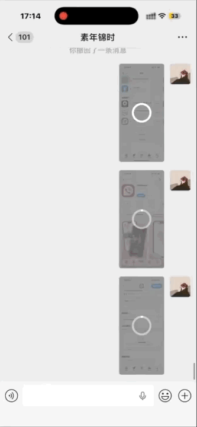
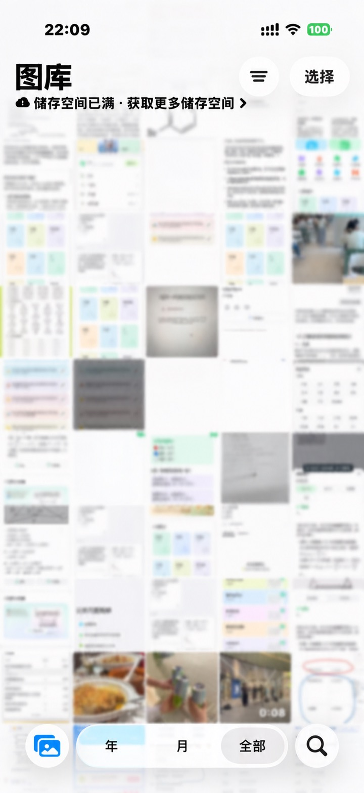

<p align="right"><a href="./README.md">简体中文</a> · <strong>English</strong></p>

# ShotCleanup

> Send the screenshot. Then get it out of Photos while the moment is still fresh.

[](https://www.apple.com/ios/)
[](https://www.swift.org/)
[](./docs/how-it-works.md)
[](./LICENSE)

<p align="center">
  <a href="./assets/shotcleanup-demo.mp4"></a>
</p>
<p align="center"><sub>After sending, triple-tap the back of your iPhone, review the batch, and confirm deletion. Click the GIF for the original video.</sub></p>

I am a product manager, so I take screenshots every day: a bug I need to share with the team, a product detail worth discussing, or an error message someone needs to see.

Most of those screenshots have done their job once they are sent. But I do not leave the conversation, reopen Photos, find the same images, and delete them. I do not have a weekly screenshot-cleaning habit either.

Eventually, Photos fills up with product screens, chat records, and error messages I only needed once.

<p align="center">
  
</p>

Most photo-cleanup tools help after the clutter has accumulated: open another app, review a backlog, and clean it in batches. My problem is not that batch cleanup is too slow. It is that I never come back to do it.

**Deletion only happens when it is easy enough.**

ShotCleanup is therefore not a periodic photo organizer. It puts deletion at the moment a screenshot has finished its job:

**After sending screenshots, triple-tap the back of your iPhone.**

ShotCleanup finds the batch you just sent and asks iOS to show the final count and previews. Nothing is removed until you confirm, and the copies already sent in chat are not affected.

## How to use it

1. Take screenshots and send them as usual.
2. Stay on the page where the sent image is visible, then triple-tap the back of the iPhone.
3. Check the photos ShotCleanup found. If they are correct, confirm deletion.

## How it works

iPhone does not tell ShotCleanup which photos you just sent. ShotCleanup first identifies the bottom-most screenshot on the page, then finds the other screenshots captured immediately before and after it. Even if you sent 10 screenshots and only the last few remain visible, it can still recover that batch.

Everything runs locally on the iPhone. ShotCleanup does not read chat history or upload images.

ShotCleanup finds a continuous batch of screenshots; it does not know which ones were actually sent. An unsent screenshot from the same batch may also be selected, so check the photos before deleting them.

[Read the detailed explanation](./docs/how-it-works.md)

## Best-fit workflow

ShotCleanup is designed for **take screenshots → send them soon → stay on the sent screen → clean them up immediately**. It is not a historical photo-library organizer, and an old screenshot resent days later will not be considered.

## Installation

You need a Mac, an iPhone running iOS 18 or later, and the full Xcode app installed on the Mac.

**A paid developer membership is not required.** A normal Apple Account can install the app on the account owner's iPhone, but free signing expires after 7 days. Ask the agent to reinstall it when that happens. See [Apple's account overview](https://developer.apple.com/help/account/basics/about-your-developer-account/).

### Easiest path: give the task to an agent

Give this entire prompt to Codex, Claude Code, WorkBuddy, or another coding agent with terminal access to the Mac:

```text
Install ShotCleanup directly on the iPhone currently connected to this Mac. Then guide me through the Shortcut and Triple Tap setup. Do the work instead of only explaining the steps.

Repository: https://github.com/echo-builds/ShotCleanup-public
Read and follow the repository's INSTALL.md first.

When I need to act, give me only the current action and continue after I finish. Never ask me for an Apple Account password, verification code, or recovery key.
```

During installation, you may need to sign in to Xcode, unlock and trust the iPhone, or enable Developer Mode. The agent handles the rest.

### Configure the iPhone after installation

The agent should guide you through these steps one at a time:

1. Open ShotCleanup and allow full photo access.
2. In Shortcuts, create a shortcut with `Take Screenshot`, followed by ShotCleanup's `识别刚发送的截图`; pass the screenshot result into the second action.
3. Open `Settings → Accessibility → Touch → Back Tap → Triple Tap` and choose that shortcut.
4. Test with unimportant screenshots first and verify the count and previews before confirming deletion.

<details>
<summary>Install manually with Xcode</summary>

1. Download the repository and open `ShotCleanup.xcodeproj` in Xcode.
2. Under `Signing & Capabilities`, select your Apple Account and Team, then use a unique Bundle Identifier.
3. Connect and unlock the iPhone, select it as the run destination, and click Run.
4. Complete the iPhone setup above.

</details>

## Local checks

The checks for image matching and time-batch inference run without an iPhone:

```sh
swiftc -O ShotCleanup/ThumbnailMatcher.swift ShotCleanup/ScreenshotBatchInference.swift Checks/MatcherChecks.swift -o /tmp/shot-cleanup-checks
/tmp/shot-cleanup-checks
```

## License

[MIT](./LICENSE)
